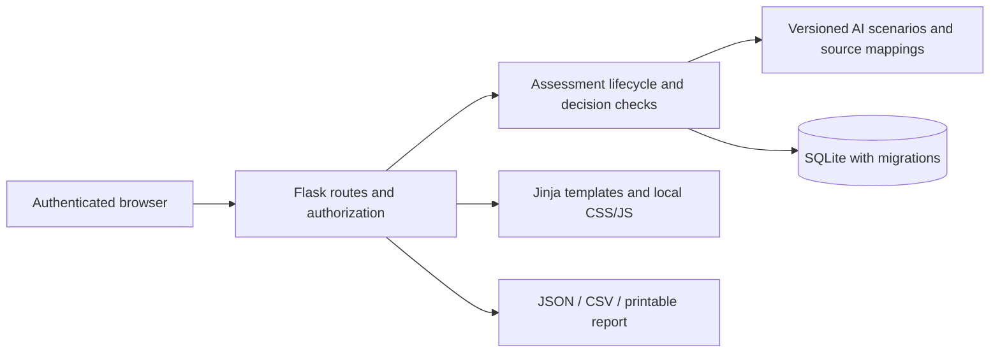

# AIrisk architecture

AIrisk is a server-rendered Flask application for one organization's AI adoption decisions. The current domain model replaces the original generic NIST SP 800-30 wizard. The original generated reports are retained only as historical material in `docs/archive/`.

## Domain and responsibilities

| Component | Responsibility |
| --- | --- |
| `airisk/__init__.py` | Application factory, configuration, CSRF, security headers and conflict handling |
| `airisk/models.py` | Users, vendors, systems, assessments, risks, evidence, action follow-up, audit events and login attempts |
| `airisk/catalog.py` | Versioned original scenarios, scope routing and source references |
| `airisk/services.py` | Context snapshots, completeness, approval checks, monitoring signals and export payloads |
| `airisk/web.py` | Input validation, authentication, permissions and HTTP workflows |
| `airisk/claude.py` | Scoped Claude web/Enterprise prompts, response validation and explicit draft acceptance |
| `airisk/cli.py` | Account administration and opt-in fictional examples |
| `run-windows.cmd`, `run-local.sh`, `run_local.py` | Native local setup, dependency reuse, migrations and localhost Waitress server |
| `migrations/` | Explicit Alembic migrations; no automatic `create_all` in application startup |
| `templates/`, `static/` | Accessible HTML forms, responsive views and progressive enhancements |

Each assessment snapshots the system context, relevant vendor facts, source metadata and selected risk definitions. Later editorial changes do not rewrite its scenario text or mappings. System/vendor changes are detected against the snapshot. The current catalog review deadline and evidence expiry are evaluated at read/decision time and can flag a historical approval for renewed review.

## Lifecycle

```mermaid
stateDiagram-v2
  [*] --> Draft
  Draft --> InReview: Complete every risk or justify exclusion
  InReview --> Draft: Reviewer requests changes
  InReview --> Approved: Evidence and applicability checks pass
  InReview --> Conditional: Checks pass; remaining actions assigned
  InReview --> Rejected: Record reason not to proceed
  Approved --> [*]
  Conditional --> [*]
  Rejected --> [*]
```

Terminal decisions are immutable through the application. A conditional decision can acquire separate action-completion records; another reviewer verifies completion. These records do not alter the original ratings or decision. Reassessment creates a new record from current context. The initial release intentionally asks the author to reassess rather than automatically copying potentially outdated answers.

Risk ratings use a documented local likelihood × impact scale. Unknown inputs have no score. Server-side validation rejects out-of-range values. High residual risks require conditional treatment with an open assigned action; critical residual risks block approval. None of these bands is an EU legal risk class. EU screening is conservative routing, followed by a recorded human applicability review.

## Access and integrity

All active members can read all records in this single workspace. The assessment author, system owner or administrator edits a current draft. Reviewers/administrators verify evidence and decide assessments, but cannot verify their own evidence or decide an assessment they authored, own, or contributed risk answers to. Administrators manage accounts; disabling an account or resetting its password revokes existing sessions through a server-side version check.

Passwords use Werkzeug's scrypt hashing. Cookies contain the user identity, session version and framework session metadata, not assessment content. Every mutation requires CSRF protection. Production requires a sufficiently long externally supplied secret and uses Secure/HttpOnly/SameSite cookies. Request sizes are bounded, templates autoescape text, external evidence links require HTTPS and are never fetched by the server, and CSV exports neutralize formula prefixes.

Optimistic versions on risks and assessments reject conflicting writes. Draft risk edits also advance the assessment version to conflict with simultaneous lifecycle transitions. Application audit events record account, context, evidence and decision changes. This audit log is not tamper-proof against a database/server administrator and does not claim forensic-grade event sourcing.

## Deployment and storage

The local launcher runs Waitress with four threads on native Windows, Linux or macOS. Windows uses `.venv-windows/` and requires neither WSL nor Docker; Gunicorn is excluded from Windows dependency installation. The optional Linux container retains Gunicorn with one worker and four threads. Both serve the same Flask application and use the same database and signing key. SQLite foreign keys and a busy timeout are enabled. The application is intended for a small internal workspace, not unbounded concurrent writes or multiple independent tenants. Startup applies migrations; the health endpoint checks schema access. Deploy one application instance for this release. PostgreSQL, rolling migrations and multi-instance behavior have not been validated.

Claude assistance uses a human-controlled web handoff with preserved requests/responses and context fingerprints. Imported advice is validated and selected draft reasoning/ratings require explicit acceptance; reviewer critiques cannot change decisions. There is no direct model API call, background worker, vendor scraping or automatic document ingestion. See [Claude assistance](docs/CLAUDE_ASSISTANCE.md). Evidence consists of dated notes and optional links to an organization's existing document store. The application cannot verify the truth of an uploaded claim; a named person must review it. Browser exports and backups can contain confidential information and need the organization's normal handling controls.

See [operations](docs/OPERATIONS.md) for startup, backup and recovery, and [the roadmap](docs/REVIEW_AND_ROADMAP.md) for the next product increments.
